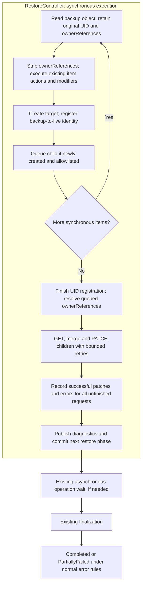

# OwnerReference Relinking

## Executive Summary

During a Kubernetes restore, newly created objects receive fresh UIDs. Velero strips `metadata.ownerReferences` before creating resources to avoid references to non-existent backup UIDs. Custom resources and operator-managed dependents can consequently lose ownership relationships that their controllers rely on.

This design reconstructs eligible ownership links using existing backup data and one relinking stage within synchronous restore execution:

1. **Capture and Register:** Retain backup UIDs and ownerReferences, restore resources with ownerReferences stripped, and register backup-to-live identities for created objects and eligible existing parents. Independently enqueue newly created children selected by the relinking allowlist.
2. **Resolve and Relink:** After synchronous resource restoration completes, resolve original parent UIDs using the completed in-memory map. GET each eligible live child, merge resolved references with its live references, and PATCH with a resourceVersion precondition. Retry conflicts and transient API failures in place with bounded backoff.
3. **Report and Continue:** Count successful child patches. Record permanent failures, retry exhaustion, and requests unattempted when the stage budget expires as restore errors. Commit diagnostics and status through the existing restore flow, then continue any existing async-operation wait and finalization. Relinking errors result in `PartiallyFailed` under normal completion rules.

The relinking stage does not require archive changes, global topological sorting, durable retry storage, or another Restore phase. Its state lasts only for the current restore execution. An interrupted `InProgress` restore is not resumable by this feature.

---

## Background & Problem Statement

### OwnerReferences and Garbage Collection

An `ownerReference` identifies a parent object by `apiVersion`, `kind`, `name`, and `UID`, optionally specifying `controller` and `blockOwnerDeletion` flags. Newly created objects receive new UIDs during restore. Reusing backed-up owner UIDs exposes restored children to immediate Kubernetes garbage collection because those original UIDs do not exist in the destination cluster.

Velero's `resetMetadataAndStatus()` strips `metadata.ownerReferences` before creation. This avoids dangling references, but custom operators may not automatically adopt the resulting orphans. While built-in workload controllers have established selector-based adoption behavior, custom controllers (such as Cluster API, KubeVirt, or Knative) rely strictly on ownerReferences for lifecycle tracking.

The restoration pipeline can create children before their parents. Rather than imposing a fragile global topological order, this design creates objects without ownerReferences and relinks them once synchronous restoration finishes and eligible parent UIDs are known.

### Controller Races Are an Operational Boundary

Active controllers can observe restored resources before their ownership relationships are established. Relinking alone does not prevent duplicate provisioning or other controller mutations during this interval. Workloads that cannot tolerate this intermediate state require external controller suspension; see [External Pause and Resume Procedure](#external-pause-and-resume-procedure) for operational guidance.

---

## Terminology & Glossary

- **Child allowlist:** Effective GroupKind selection from baseline and per-restore configuration; it determines which newly created children are queued for relinking. It does not restrict parent UID registration.
- **Resource scope:** Whether discovery identifies a kind as namespaced or cluster-scoped, or cannot determine its scope. This is independent of the child allowlist.
- **UID mapping:** In-memory lookup from an object's backup UID to a `UIDMappingRecord` describing the corresponding destination object's live UID, GroupKind, served API versions, name, namespace, and resource scope.
- **Child request:** An in-memory `OwnerPatchRequest` containing the destination child identity, created child UID, discovered scope, and original ownerReferences with backup parent UIDs.
- **Relinking stage:** Resolution and child GET/merge/PATCH processing after synchronous item restoration. All API attempts and backoff share a stage budget of `resourceTimeout` (default 10 minutes).
- **Live precedence:** Preserve an existing live controlling owner and demote a different incoming restored controlling owner to preserve the ownership link while avoiding multiple controlling owners.

---

## Goals & Non-Goals

### Goals

- Relink allowlisted ownerReferences using data already present in existing backup archives.
- Preserve existing resource priorities and native workload adoption behavior.
- Resolve parent identities from the completed in-memory UID map and relink in one synchronous stage.
- Preserve live references through GET/merge/PATCH with optimistic concurrency control.
- Handle transient child API failures with bounded in-place retries and backoff.
- Report unfinished or failed relinking through normal restore diagnostics and error/phase handling.
- Gate the feature with `--features=OwnerRefRelink`, retaining baseline and per-restore allowlist ConfigMaps.
- Expose the successful child-patch count through Restore status and CLI output.

### Non-Goals

- Backup-side graphs, sidecar manifests, archive format changes, or global topological sorting.
- Relinking or rewriting UID-bearing object references within resource `.spec` or `.status`.
- Automated controller pause injection or unpause orchestration.
- Relinking pre-existing objects through update, skip, or ServiceAccount merge paths, although eligible existing identities can supply parent UIDs.
- Relinking a Namespace's own ownerReferences; Namespaces participate only as eligible parents.
- Durable relinking checkpoints, automatic replay, or resumption after an `InProgress` crash.
- Running relinking again during async waiting or finalization.
- Authorizing cross-namespace ownership; namespaced owners must share their child's namespace, and cluster-scoped children may have only cluster-scoped owners.

---

## Core Architecture & Restore Workflow

### High-Level Workflow Diagram



The diagram shows the successful create path; eligible existing resources also register parent identities through their existing update/merge/skip paths. There is one relinking stage after the synchronous item loop, regardless of resource creation order. Async controllers and the finalizer do not reload or retry relinking requests.

### Worked Example: Child Created Before Parent

Consider a backup containing a namespaced `WidgetSet` named `workers` (UID `parent-old`) and an allowlisted `Widget` named `worker-1` whose ownerReference points to `workers`. Both belong to `workloads.example.io`; names, kinds, and namespaces remain unchanged during restore.

1. **Child Restored First:** `worker-1` (backup UID `child-old`) is restored with ownerReferences stripped and receives live UID `child-new`. Velero records `uidMap[child-old]` with `LiveUID: child-new`, even though the object is being described as a child: another object may reference it as a parent. Independently, because this newly created child is eligible under the allowlist, Velero enqueues an `OwnerPatchRequest` with its target identity, `RestoredUID: child-new`, discovered scope, and original ownerReference still containing `parent-old`.
2. **Parent Restored Later:** `workers` is created with live UID `parent-new`. Velero records `uidMap[parent-old]` with live UID `parent-new`, GroupKind `workloads.example.io/WidgetSet`, name `workers`, target namespace, and namespaced scope.
3. **Relink Child:** After synchronous restoration completes, the relinking stage resolves the queued owner UID `parent-old` to `parent-new`, performs a live GET on `worker-1`, merges ownerReferences, and patches the object using its current `resourceVersion`.
4. **Outcome / Retry:** A successful patch increments `OwnerRefsRelinked` by 1. A transient failure such as 429 or timeout is retried in place. If the retry limit or stage deadline is reached, record a restore error identifying `worker-1` and the unfinished relinking operation; no later relinking attempt is scheduled. Existing async work and finalization still proceed, carrying the error toward `PartiallyFailed`.

This architecture decouples restoration order from resource creation priorities: parents and children resolve naturally without topological sorting.

---

## Data Structures and API Additions

### Internal Restore State

Synchronous restoration registers each successfully created object's backup UID and live identity, independently of whether the object is eligible as a relinking child. Eligible existing targets can also supply parent identities through the update, merge, or equal-skip paths. Registration does not require knowing in advance whether another object references this object.

```go
// Internal state for the current synchronous restore execution.
type ResourceScope uint8

const (
    ScopeUnknown ResourceScope = iota
    ScopeNamespaced
    ScopeCluster
)

type UIDMappingRecord struct {
    LiveUID           types.UID
    GroupKind         schema.GroupKind
    APIVersion        string
    ServedAPIVersions []string
    Name              string
    Namespace         string
    Scope             ResourceScope
}

// Key: original UID from the backup.
// Value: identity of the corresponding destination object.
// uidMap map[types.UID]UIDMappingRecord
```

For example, `uidMap["parent-old"].LiveUID == "parent-new"`. The map is not keyed by the new UID.

`Namespace` is the actual destination namespace; `Scope` is the resource kind's scope obtained from discovery. Empty namespace alone does not prove cluster scope. The three-state field has zero value `ScopeUnknown`, which never authorizes a relationship. A namespaced owner must share its child's destination namespace, and a cluster-scoped child may only have cluster-scoped owners.

### In-Memory Child Queue

The queue is separate from the identity map and contains only newly created, allowlisted children with original ownerReferences:

```go
type OwnerPatchRequest struct {
    Group           string
    Version         string
    Kind            string
    Namespace       string
    Name            string
    RestoredUID     types.UID
    Scope           ResourceScope
    OwnerReferences []metav1.OwnerReference
}
```

At enqueue time, `OwnerReferences` is a copy of the original backup references and therefore contains **backup parent UIDs**. The other identity fields identify the destination child. The relinking stage resolves the parent UIDs through `uidMap` after synchronous registration is complete. Resolved references remain in memory for the current request and its retries; the backup UID map and queue are not serialized.

`RestoredUID` identifies the **child** created by this restore; the UIDs in ownerReferences identify its **parents**. Comparing a fetched child's UID with `RestoredUID` detects deletion and recreation under the same name. Under the [replacement policy](#replacement-child-policy), a mismatch causes a warning and patching proceeds against the replacement. This is a diagnostic identity check, not a precondition requiring the original child UID to survive.

### Restore API Extensions

```go
type RestoreSpec struct {
    // Existing fields omitted.
    OwnerRefConfigMap *corev1.TypedLocalObjectReference `json:"ownerRefConfigMap,omitempty"`
}

type RestoreStatus struct {
    // Existing fields omitted.
    OwnerRefsRelinked int `json:"ownerRefsRelinked,omitempty"`
}
```

`OwnerRefsRelinked` counts successfully patched **children**, rather than individual entries in their ownerReferences arrays. Increment once for a child whose PATCH is acknowledged successful, regardless of its reference count or retry count. It is a diagnostic counter, not a durable per-child completion ledger. Relinking warnings and errors use existing restore reporting; there is no pending queue in Restore status.

The data lifecycle is: register destination identities and queue original child requests, resolve parent identities, GET/merge/PATCH with retries, then retain only the ordinary results and diagnostics. Internal state can be released after the relinking stage has reported its outcomes.

---

## Detailed Restore Pipeline Execution

### Synchronous Restoration: Create and Register UIDs

In `restoreItem()`:

1. Retain `itemFromBackup` unchanged and copy its original UID and ownerReferences before invoking `resetMetadataAndStatus()`.
2. Execute existing restore item actions and ResourceModifiers on `obj`.
3. Immediately after a successful `resourceClient.Create(obj)`, register `uidMap[backupUID]` with the created object's live identity, whether or not its GroupKind is allowlisted as a child. If the newly created child has backup ownerReferences and is eligible under the [effective relinking allowlist](#effective-scope-evaluation), enqueue an `OwnerPatchRequest` containing the target child identity, created child UID, discovered resource scope, and original backup ownerReferences. Register before status updates, managedFields patches, or hooks that might exit early.
4. Obtain resource scope from RESTMapper metadata during synchronous restoration and cache it in `UIDMappingRecord` and, where queued, `OwnerPatchRequest`. Record `ScopeUnknown` if discovery cannot determine scope; affected relationships are omissions with warnings.
5. For update, ServiceAccount merge, and equal-skip paths, record target identity records only; do not enqueue ownerReference patches against existing objects.
6. For Namespaces, register backup-to-live UID mappings for newly created or eligible existing Namespaces so dependent resources can resolve them. Namespaces themselves are never queued as children.

### OwnerReference Relinking Stage

`RestoreController` invokes `ApplyOwnerRefRelinking()` immediately after synchronous `RestoreWithResolvers` completes, before publishing the results and committing the phase that leads to async waiting or finalization. A stage-local timeout or child failure is returned through the normal warning/error result path, so it does not bypass the remaining restore lifecycle.

1. **Finish UID Registration:** Complete all synchronous registration, then treat the map as read-only. This is a lifecycle boundary, not a separate Restore phase, a required map copy, or a persistence operation.
2. **Resolve Queued References:** For each queued child, look up each backup parent UID in the completed map and validate GroupKind, name, destination namespace, discovered scope, and a destination-served API version. Omit invalid, missing, or excluded owners with warnings. Perform no parent GETs or separate parent UID refresh. If no original references resolve, submit no child patch.
3. **GET, Merge, and PATCH:** GET the live child, compare its UID with `RestoredUID`, merge its live references with the resolved references in memory, and PATCH the resulting array with the live resourceVersion. “Merge” is the local calculation; “PATCH” is the API write. Preserve live controller precedence and the defined replacement-child policy.
4. **Retry Within Bounds:** Retry conflicts and transient API failures in place. Every retry starts with a fresh child GET and recomputes the merge, because a concurrent controller may have changed the child or a previous PATCH may have succeeded despite a lost response. Reuse resolved parent identities from the completed map. Treat all Forbidden responses as permanent failures; never weaken ownerReference flags automatically.
5. **Record Each Outcome:** Increment `OwnerRefsRelinked` once for an acknowledged successful child patch. Missing or invalid owner omissions remain warnings. Permanent child errors and exhausted retries become restore errors; continue other children while the stage budget permits.
6. **Account for Unfinished Work:** On stage deadline expiry, report an error for the interrupted eligible request and every remaining child with resolvable references that could not be attempted. Identify each affected child in diagnostics and include a summary count. Requests whose references all resolve to omissions remain warning-only. Do not silently treat unprocessed work as successful.
7. **Return Results:** Merge relinking outcomes with the synchronous restore results and use the existing results upload and status/phase commit path. The finalizer consumes the resulting normal restore state; it does not perform ownerReference work.

### Retry and Timeout Contract

All child GETs, PATCHes, conflict retries and backoff delays share one stage context derived from the restore context with `resourceTimeout` (default 10 minutes). The budget begins when the relinking stage starts, not when resource creation begins; it is shared across children and is never reset for a request or retry.

Use client-go `retry.DefaultBackoff`: **four total GET/merge/PATCH attempts per child**, with a 10 ms initial delay, factor 5, and jitter 0.1 (nominal delays 10 ms, 50 ms, and 250 ms, each with jitter). A GET failure consumes an attempt without PATCHing; a successful GET followed by a failed PATCH consumes that same attempt. Every later attempt starts with a fresh GET and merge. The policy is copied locally for each child and never mutates the shared client-go variable.

Retry HTTP 409 conflicts, 429 throttling, Kubernetes timeout/server-timeout errors, 500 internal errors, 503 service-unavailable errors, unexpected server failures, and recoverable transport failures (timeouts, resets/refusals, EOF, or lost HTTP/2 connections). Honor Kubernetes Retry-After hints as a minimum wait when greater than the normal backoff. Neither server hints nor local backoff may extend the shared stage deadline. Cancellation stops immediately; other errors, including 400, 401, 403, 404, and 422, stop that child's retries.

Reaching four attempts or the shared stage deadline ends retries and reports the unfinished request as a restore error. Continue other children while time remains. Use the existing client-go policy rather than introducing feature-specific retry flags, while keeping error classification aligned with the broader critical network-call resilience work.

A stage deadline means unfinished work is recorded as errors and the restore can proceed through its normal lifecycle. Failure to persist the resulting diagnostics or status is handled by existing restore behavior; this design does not introduce a second commit protocol or promise recovery from such failures. If the parent restore context is canceled or the process shuts down, stop API work rather than detaching retries; the process may be unable to publish final diagnostics or status.

### Results and Completion Contract

| Outcome | Restore reporting | Later behavior |
| :--- | :--- | :--- |
| A parent is missing from the UID map, excluded, invalid, or cannot be safely resolved | Warning for the omitted relationship; patch other valid references | Normal completion rules apply; omissions alone do not force failure. |
| Child patch succeeds | Increment successful child-patch count | Continue other children and normal restore processing. |
| Child operation fails permanently | Restore error with child identity and cause | Continue remaining work; carry the error through async waiting/finalization. |
| Child retries exhaust | Restore error with child identity and last failure | No deferred retry; normal error rules lead to `PartiallyFailed`. |
| Stage deadline interrupts or leaves eligible work unattempted | Errors identifying unfinished eligible children, plus a summary | Continue the existing restore lifecycle with errors. |
| Restore context is canceled or process exits | Stop calls and backoff; reporting is best effort within existing lifecycle behavior | No automatic reconstruction or replay of the in-memory work. |

Relinking errors must be included before selecting the existing next phase. For example, if async operations remain, use the existing partially-failed waiting path; otherwise use the existing partially-failed finalizing path. A later successful async operation must not clear those errors. The final phase can be `Completed` only when standard restore criteria permit it; any relinking error prevents it. Warnings and the successful-patch counter do not introduce extra completion conditions.

---

## OwnerReference Patch Mechanics

### Emitted OwnerReference API Version

The emitted reference must identify the resolved destination parent using an API version currently served by the destination cluster. Before choosing a version, validate that the backup reference's GroupKind and name match the parent's registered destination identity; a mismatch is omitted with a warning. Velero selects the emitted `apiVersion` for matching references using the following strict precedence:

1. **Live Reference Version:** Retain the live reference's `apiVersion` if destination discovery confirms it is currently served.
2. **Resolved Incoming Version:** Preserve the backed-up incoming `apiVersion` if destination discovery confirms it is currently served.
3. **Parent Destination Version:** Fall back to the served `apiVersion` recorded for the restored or eligible existing parent in the destination cluster.

For example, if a backup refers to `example.io/v1beta1` but the destination only serves `example.io/v1`, use the parent's destination-served `example.io/v1`; never blindly emit the removed backup version. If no destination-served version can be selected, omit the relationship with a warning.

*GroupKind* and *name* are never altered. Unrelated live references are preserved without modification.

### Merge and Retry Rules

- **Full Array Replacement:** Kubernetes merge patches replace the entire `ownerReferences` slice. Velero fetches live references, merges them in memory, and submits the unified array with the live `resourceVersion`.
- **Identity Matching:** Match incoming and live entries by `(Group, Kind, Name)`, ignoring the API version suffix.
- **Live Controller Precedence:** Preserve an existing live controlling owner (`controller: true`). If a different eligible incoming restored owner also specifies `controller: true`, retain that incoming reference with `controller: false` and log a demotion warning. The conflict concerns control, not the validity of the ownership link. Skipping the entry would lose the link; demotion preserves the relationship and its garbage-collection participation while avoiding a second controlling owner. A matching reference to the same owner is not this conflict case.
- **Forbidden:** Treat every 403 as a permanent child error and retain the requested flags. Do not strip `blockOwnerDeletion` or reinterpret a rejection by matching its message. Administrators must provide the required permissions or explicitly change their restore policy; the engine never weakens foreground-deletion semantics after an authorization failure.
- **Conflict Handling:** On HTTP 409 Conflict, re-fetch the live child, reassess replacement identity, re-merge references, and retry within the stage budget.
- **Transient API Failures:** Retry 429, timeouts, and recoverable network failures in place with bounded backoff. A timeout or network reset can leave PATCH success uncertain, so re-read the child and re-merge rather than replaying a stale array. Retry exhaustion and stage timeout are restore errors. Every retry consumes the same attempt/time limits; no separate permission retry loop exists.

### Merge Field Precedence

Logical identity is `(Group, Kind, Name)`; the UID identifies a particular instance of that logical owner. Resolve the incoming UID before merging. Preserve unrelated live entries byte-for-byte, including their flags and API versions. For a matching logical owner:

| Field or condition | Result |
| :--- | :--- |
| UID | Use the resolved incoming destination UID, replacing a stale live UID for the same logical owner. |
| apiVersion | Use the served live version first, then the served incoming version, then the registered destination parent version. |
| Same UID, live controller explicitly true or false | Preserve that live value; nil alone permits using the incoming controller value. |
| Same UID, live blockOwnerDeletion explicitly true or false | Preserve that live value; nil alone permits using the incoming blocking value. |
| Different UID, live controller is true | Preserve controller:true for that logical owner while replacing its stale UID. |
| Different UID, other flags | Use incoming flags; do not inherit blocking flags or explicit controller:false from the previous UID. |
| Different incoming controlling owner while a controller already exists in the merged array | Retain its ownership link and set controller:false with a warning. |
| Repeated incoming logical identity | Keep the first resolved entry in backup order and warn for later duplicates. |

When no live controlling owner exists, the first incoming controlling owner in backup order remains controlling and later conflicting controlling owners are demoted. Nil and explicit false are preserved according to the table. Merge operates on copies and must be idempotent: a fresh GET after an uncertain PATCH response must not duplicate references or change precedence. Acknowledged success increments the child count once, irrespective of how many attempts were made.

### Why blockOwnerDeletion Can Produce Forbidden

Kubernetes' built-in `OwnerReferencesPermissionEnforcement` admission controller can reject these patches without any custom webhook. Changing an existing child's ownerReferences requires delete permission on that child. Setting a new `blockOwnerDeletion: true` also requires permission to update the referenced owner's `finalizers` subresource. Patch permission on the child alone is therefore insufficient. See the [admission controller documentation](https://kubernetes.io/docs/reference/access-authn-authz/admission-controllers/#ownerreferencespermissionenforcement) and [implementation](https://github.com/kubernetes/kubernetes/blob/master/plugin/pkg/admission/gc/gc_admission.go).

A generic Forbidden response does not provide a stable, field-specific signal for automatically relaxing ownership flags. The initial implementation therefore has no automatic permission fallback: report the child error with its original cause and continue other children while the stage budget permits. Removing a blocking flag would also not remedy missing patch or child-delete permission.

### Failure Classification Matrix

| Condition | Classification | Behavior |
| :--- | :--- | :--- |
| Backup owner UID absent from the completed map, or parent excluded | Omission | Omit with warning; patch other resolved references. |
| Unknown scope, mismatched parent identity/namespace, no destination-served version, or denied PVC parent | Invalid Reference | Omit with warning; do not retry the invalid relationship. |
| Fetched child UID differs from RestoredUID | Replacement Child | Warn and continue against the replacement with its current resourceVersion. |
| Child PATCH returns 409 Conflict | Transient Conflict | Back off, GET the current child, re-merge, and PATCH within attempt/time bounds. |
| Child GET/PATCH returns 429, timeout, 500/503, unexpected server failure, or recoverable network failure | Transient API Failure | Retry in place within attempt/time bounds; on exhaustion report a restore error. |
| Child GET/PATCH returns 400, 401, 403, 404, or 422 | Permanent Child Error | Report a restore error, stop this child's retries, and continue other requests. |
| Shared stage deadline expires | Unfinished Work | Stop API attempts; report errors for interrupted and unattempted children with resolvable work. |
| Parent context canceled | Cancellation | Stop calls and backoff; normal lifecycle reporting may be incomplete. |

There are no later parent-refresh or snapshot-storage failure classes. All parent identities come from synchronous UID registration; the consequences of later parent replacement are stated under [Open Issues and Limits](#open-issues-and-limits).

### Multiple Owners and Partial Resolution

Each entry in a child's original `ownerReferences` is resolved independently:

- If Parent A resolves successfully and Parent B was excluded or missing, Parent A is included, Parent B is omitted with a warning, and the patch proceeds.
- If transient patch failures exhaust the allowed attempts or stage budget, record a restore error for the child's unfinished patch. Keep other successful patches; no rollback or deferred replay is introduced.
- If no original references resolve, no patch is submitted and live references remain untouched.

### Replacement Child Policy

If a child resource was deleted and recreated under the same `(GroupKind, Namespace, Name)` prior to relinking, Velero treats the recreated object as the legitimate restore target:

1. Velero compares the fetched child's live UID against `RestoredUID`.
2. If the UIDs differ, Velero logs a warning identifying the expected and observed UIDs:
   ```text
   Relinking ownerReferences on replacement Machine default/worker-1:
   originally created UID A, current UID B.
   ```
3. The merge patch proceeds against the replacement object using its current `resourceVersion`. Successful patching increments `OwnerRefsRelinked`.

`RestoredUID` is used for this diagnostic comparison; resolved ownerReference UIDs identify parents and cannot replace it. The child UID comparison is not a requirement that the fetched child still have the originally created UID. The comparison is used only during the current relinking stage and its retries; no child identity record is persisted for replay.

---

## State Lifetime and Restore Restart Behavior

### In-Memory State and Capacity

The UID map and child queue exist only during synchronous restore execution. They are not written to ConfigMaps, Restore status, or backup archives. Their memory usage scales with registered objects and queued ownerReferences, as part of the restore workload. There is no compressed-queue size limit or inherited 10,000-pending-request cap. Large restores remain subject to normal process memory constraints and the shared stage deadline; timeout must produce diagnostics for unfinished work rather than silent truncation.

Scope-configuration ConfigMaps select eligible children; they are not work queues or checkpoints. This feature needs no snapshot ConfigMap naming, hashes, ownership labels, load/validation, replacement protocol, or garbage-collection logic.

### Restore Resumption Boundary

The restore controller starts synchronous processing only for an empty/New phase. A restart while the Restore is `InProgress` does not reconstruct its item loop, UID map, or child queue and resume from the interrupted point. Some resources may already have been patched, while others remain stripped; there is no automatic replay or rollback.

Once ordinary results and the next phase are durably committed, the existing async controllers and finalizer handle their normal phases. They carry relinking errors already recorded through to completion but do not retry patches. The feature adds no new recovery guarantees to those phases. See the [restore controller](https://github.com/velero-io/velero/blob/main/pkg/controller/restore_controller.go) and [finalizer controller](https://github.com/velero-io/velero/blob/main/pkg/controller/restore_finalizer_controller.go).

### Failure and Restart Cases

| Failure point | Consequence |
| :--- | :--- |
| Stage attempt limit or deadline reached while the process remains active | Record unfinished relinking as restore errors and continue normal restore processing. |
| Process exits during resource creation or relinking while phase is InProgress | In-memory state is lost; already-applied patches remain, and relinking does not resume automatically. |
| Diagnostics upload or next-phase status commit fails | Existing restore failure handling applies; the feature provides no separate checkpoint or guaranteed replay. |
| Process restarts during async waiting after normal results/status commit | Existing controllers continue their usual work; recorded relinking errors remain part of the outcome. |
| Finalization completes | Normal error criteria select Completed or PartiallyFailed; there is no ownerReference retry or snapshot cleanup. |

An administrator must inspect the normal restore diagnostics before deciding how to repair unresolved ownership or perform another restore. Starting a new restore is a separate operation; it is not a guaranteed replay of failed relinking because pre-existing children are not eligible for this feature's patch queue.

---

## Configuration and Scope Model

### ConfigMap Scope Schema

The child relinking allowlist is configured via a ConfigMap in the Velero namespace. Configuration “scope” means GroupKind selection, separate from the namespaced/cluster resource scope discovered through RESTMapper. The server baseline defaults to `velero-ownerref-config` (or `--owner-ref-configmap`). Individual restores can override or augment scope via `Restore.Spec.OwnerRefConfigMap` (`--owner-ref-restore-configmap`).

```yaml
apiVersion: v1
kind: ConfigMap
metadata:
  name: velero-ownerref-config
  namespace: velero
data:
  inScope: |
    # Match an entire API group (omitting kind matches all kinds)
    - group: cluster.x-k8s.io
    # Match a specific GroupKind
    - group: controlplane.cluster.x-k8s.io
      kind: KubeadmControlPlane
    - group: bootstrap.cluster.x-k8s.io
      kind: KubeadmConfig
    - group: infrastructure.cluster.x-k8s.io
```

### Effective Scope Evaluation

Both `inScope` and `outOfScope` match target **child (dependent)** resources that hold `metadata.ownerReferences`, not the referenced parents.

A child is queued only if it was newly created by this restore, has original backup ownerReferences, and is included by the union of baseline/per-restore `inScope` after subtracting per-restore `outOfScope` and applying built-in denied-kind and PVC opt-in rules. Existing objects on update, merge, or skip paths are never queued. This eligibility rule is what “child matches scope” means; it does not mean merely having known namespaced or cluster scope.

```
[Baseline inScope]  ──┐
                      ├── Union ──► [Combined Inclusions] 
[Restore inScope]   ──┘                     │
                                            ▼
                                  Minus: [Restore outOfScope]
                                            │
                                            ▼
                                  Minus: [Built-in Denied Kinds]
                                         (Pod, ReplicaSet, RC, Job, Namespace)
                                            │
                                            ▼
                                  = Effective Child Scope
```

- **Inclusions (`inScope`):** Baseline and per-restore `inScope` entries are unioned.
- **Exclusions (`outOfScope`):** Per-restore `outOfScope` matches are subtracted. Exclusions always win over inclusions (including group-wide exclusions against exact-kind inclusions). Baseline ConfigMaps must not contain `outOfScope`.
- **Parents:** Parents do not need to be in the child allowlist to supply live UIDs. Register every newly created object's identity and eligible existing identities independently; an object may be both a relinking child and a parent of another child.
- **PVC Opt-In:** Broad group matches do not substitute for an explicit per-restore `group: ""`, `kind: PersistentVolumeClaim` inclusion. PVCs remain excluded unless that opt-in is present, and exclusions still win.

### Feature Gating and Precedence

| Configuration State | System Behavior |
| :--- | :--- |
| Feature flag disabled, no ConfigMap referenced | Legacy behavior preserved; relinking engine is dormant. |
| Feature flag disabled, ConfigMap referenced | Validation error before restore starts. |
| Explicit server baseline ConfigMap missing/unreadable | Logs warning and proceeds with empty baseline. Invalid syntax fails validation. |
| Server flag unset, conventional ConfigMap missing | Logs warning and proceeds with empty baseline. |
| Per-restore ConfigMap specified | ConfigMap must be valid and readable. Unions `inScope`, applies `outOfScope`. |

### Scope and Safety Boundaries

| Resource Class | Configuration Rule | Engine Relink Behavior |
| :--- | :--- | :--- |
| **Denied Workloads**<br>(`core/Pod`, `apps/ReplicaSet`, `core/ReplicationController`, `batch/Job`) | Forbidden in `inScope` (validation error) | **Always stripped.** Relinking disabled to preserve native controller selector adoption. |
| **Namespaces**<br>(`core/Namespace`) | Forbidden in `inScope` (validation error); permitted in `outOfScope` | **Always stripped on creation.** Never queued as children. Registered live UIDs remain available for dependent resources. |
| **PersistentVolumeClaims**<br>(`core/PersistentVolumeClaim`) | Allowed in per-restore `inScope` only; forbidden in server baseline | **Stripped by default.** When opted in, relinks eligible owners while filtering out Pod, ReplicaSet, RC, and Job parents. |
| **Allowlisted Resources**<br>(e.g., CAPI CRDs, `Deployment`, `StatefulSet`) | Included in baseline or restore `inScope`, not excluded | **Created stripped, then relinked** in the synchronous relinking stage. |
| **Unlisted or Excluded Resources** | Omitted from `inScope` or matched by `outOfScope` | **Legacy strip behavior.** Created stripped, never queued for relinking. UIDs remain available for children. |

### PersistentVolumeClaim Opt-In Nuances

PVC relinking supports operator-managed storage (e.g., KubeVirt DataVolume-owned disks or Tekton workspace PVCs) where ownership-based garbage collection is critical. The special handling is a conservative **Velero policy**, not a Kubernetes requirement: restoring an ownership relationship can cause owner deletion to delete the PVC and potentially its backing storage, depending on the reclaim policy. Per-restore opt-in makes that lifecycle choice explicit instead of inheriting it from a server baseline.

This revision retains the initial per-restore opt-in proposal. The baseline restriction and the PVC parent filter are separate policy decisions; either can be reconsidered without assuming the other must change.

- **Explicit Per-Restore Opt-In Required:** To prevent unintended data loss, PVCs cannot be included in server baselines. They must be explicitly listed in the per-restore `inScope`:
  ```yaml
  apiVersion: v1
  kind: ConfigMap
  metadata:
    name: restore-pvc-ownerrefs
    namespace: velero
  data:
    inScope: |
      - group: ""
        kind: PersistentVolumeClaim
  ```
- **PVC Parent Filter:** Backed-up references pointing to Pod, ReplicaSet, ReplicationController, or Job are omitted with warnings. This is a deliberate lifecycle restriction, not proof that these are invalid Kubernetes ownership relationships.
- **StatefulSet Retention Limitation:** With `persistentVolumeClaimRetentionPolicy.whenDeleted: Delete`, StatefulSet ownership controls deletion and can be relinked when present in the backup. With `whenScaled: Delete`, the StatefulSet controller makes condemned Pods owners of the associated PVCs. Filtering Pod owners means this engine intentionally does not restore that latter relationship from the backup; it does not preserve all StatefulSet retention semantics. Subsequent controller reconciliation may manage those references independently. See [StatefulSet PVC retention](https://kubernetes.io/docs/concepts/workloads/controllers/statefulset/#persistentvolumeclaim-retention).

---

## Validation and Observability (CLI)

### Validation Rules

- Verify `--features=OwnerRefRelink` is active if `ownerRefConfigMap` is specified.
- Verify ConfigMap references point to the Velero namespace.
- Reject invalid YAML, unknown keys, binary data, or unsupported sections.
- Reject explicit denied workloads and `core/Namespace` in `inScope`.
- Reject `PersistentVolumeClaim` in server baseline ConfigMaps.
- Reject `outOfScope` in server baseline ConfigMaps.

### CLI Inspection

`velero restore describe` reads the successful child-patch count directly from `Restore.Status`. Detailed omissions, failures, retry exhaustion, and unattempted children appear in the normal restore warnings/errors and logs:

```text
OwnerReference Relinking:
  ConfigMap:           velero-ownerref-config
  Relinked Children:   48 items
```

---

<a id="external-pause-and-resume-procedure"></a>
## Operational Considerations: External Pause and Resume Procedure

### Why Controller Suspension May Be Needed

Because resources are created without ownerReferences and relinked only after synchronous restore finishes, active controllers running in the destination cluster may observe intermediate states:

```
[Backup State]            Parent P owns Child C

[Restore Step 1]          Child C created (ownerReferences stripped)
                          Parent P created (not yet linked to C)

[Controller Race Window]  Controller reconciles Parent P before relinking C.
                          Controller does not recognize C and provisions duplicate Child C'.

[Restore Step 2]          Relinking establishes P -> C. Duplicate C' remains!
```

Workloads vulnerable to this race require external controller suspension until restoration completes.

### Injecting Pauses with ResourceModifiers

Use Velero's existing ResourceModifier feature to inject pause annotations on root resources during creation:

```yaml
apiVersion: v1
kind: ConfigMap
metadata:
  name: restore-controller-pauses
  namespace: velero
data:
  resource-modifiers.yaml: |
    version: v1
    resourceModifierRules:
      - conditions:
          groupResource: clusters.cluster.x-k8s.io
          namespaces:
            - source-workloads
        mergePatches:
          - patchData: |
              metadata:
                annotations:
                  cluster.x-k8s.io/paused: ""
```

Run restore specifying both modifiers and relinking scope:

```bash
velero restore create cluster-restore \
  --from-backup cluster-backup \
  --owner-ref-restore-configmap velero-ownerref-config \
  --resource-modifier-configmap restore-controller-pauses
```

### Operational Checklist for Administrators

1. **Pre-Restore:** Inventory pre-existing pauses. Configure GitOps to prevent automated reconcilers from stripping injected pause annotations during restore.
2. **Execute Restore:** Trigger restore with pause ResourceModifiers and ownerRef configuration.
3. **Inspect Results:** Check restore warnings/errors, the relinked-child count, and data movement status. Relink errors require inspection; there is no queued finalizer retry to wait for.
4. **Resume Controllers:** Once ownership and workload readiness are verified, manually unpause controllers:
   ```bash
   kubectl annotate clusters.cluster.x-k8s.io -n target-workloads prod-cluster cluster.x-k8s.io/paused-
   ```

---

## Compatibility and Relationship to Prior Research

### Compatibility

- The feature is disabled by default behind the `OwnerRefRelink` feature flag.
- Backups created by older Velero versions remain fully compatible without modification.

### Key Distinctions from Prior Proposal

The earlier [proposal](https://github.com/velero-io/velero/pull/10556) attempted to bundle three distinct features: ownerReference relinking, automated controller pause/unpause orchestration, and spec-level UID rewriting. This design isolates and refines the core relinking engine:

1. **Decoupled Controller Pause Orchestration:** Automated pause injection and unpause tracking are deferred. Operational pauses are handled via existing ResourceModifiers and manual runbooks, avoiding complex root-dependency tracking.
2. **Omission of Spec/Status Rewriting:** Rewriting UIDs embedded inside `.spec` or `.status` is excluded. That capability serves different use cases and requires dedicated schemas and safety boundaries.
3. **One Relinking Stage:** Resolve and patch after synchronous resource restoration using bounded in-place retries. Restore warnings/errors and the successful child-patch count are the only retained results; unfinished work is reported through the normal restore error path.
4. **Configuration Only:** ConfigMaps select the child allowlist. Durable patch storage, pending status fields, snapshot ownership/cleanup, and finalizer relinking are excluded.

---

## Alternatives Considered

- **Backup-Side Dependency Graph:** Not selected. Existing backup ownerReferences and restore-side identity registration are sufficient; an archive-side graph would add format and version coupling.
- **Global Topological Sorting:** Not selected. Delaying relinking until synchronous registration completes preserves existing resource priorities without requiring parents to be created before children.
- **Durable Finalizer Relinking Pass:** Dropped for this draft's assumed decision. Transient failures are handled by bounded retries at the operation site, and async volume movement alone establishes no need for another ownership pass. Additional snapshot storage and replay complexity would not make an interrupted InProgress restore resumable.
- **Durable Queue Sharding or Alternative Snapshot Storage:** Unnecessary for this design because failed requests become ordinary restore errors instead of durable work. There is no pending queue to fit into one or more ConfigMaps.
- **Unbounded Retries:** Not selected. A finite per-child attempt limit and shared stage deadline bound restore latency and make unfinished work visible through errors.

---

## Open Issues and Limits

- **Live Controller Interference:** Controllers can act before relinking and may create duplicate dependents. Live precedence avoids multiple controlling owners but cannot prevent those external actions; susceptible workloads need external suspension.
- **Parent Identity Stability:** Parent UIDs are captured during synchronous registration and reused throughout relinking. If an owner is deleted/recreated after registration, a reference can become stale; this design does not re-GET parents or refresh successful links later. Parent stability during the operation is an operational assumption, not a guarantee supplied by in-place child retries.
- **Partial Results and Crash Boundary:** Successful patches remain applied when other patches fail. The feature offers no rollback, durable pending work, or automatic resumption of an interrupted InProgress restore.
- **Scale and Shared Deadline:** A large queue can exhaust the stage budget before all children are patched. Diagnostics must identify unfinished eligible work, and operators may need to narrow the allowlist or adjust the existing timeout for their restore scale.
- **PVC Policy:** Per-restore opt-in and the parent filter remain the initial policy. Filtering Pod ownership intentionally does not restore StatefulSet scale-down retention links from backup; that policy can be reconsidered independently of the dropped finalizer pass.
- **Forbidden Responses:** All authorization/admission Forbidden failures are permanent for the affected child. Automatic flag removal is excluded from the initial implementation so restore semantics do not depend on parsing server error messages.
- **Retry Policy Integration:** Use client-go `retry.DefaultBackoff` and the explicit error classification above; align future shared-policy changes with [#10754](https://github.com/velero-io/velero/issues/10754). This feature's retry handling does not replace broader resilience work for other API or object-store operations.
- **UID-Bearing Spec References:** UIDs embedded inside resource spec/status remain unchanged and may refer to old backup UIDs.
